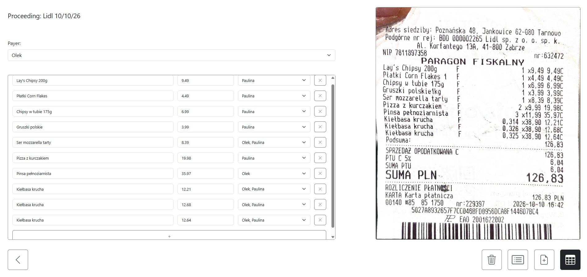
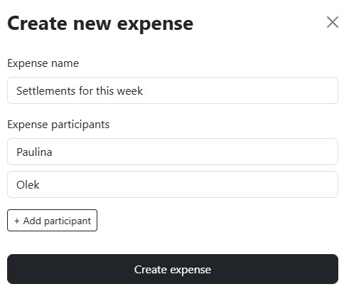
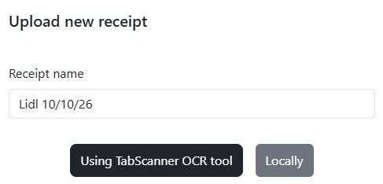
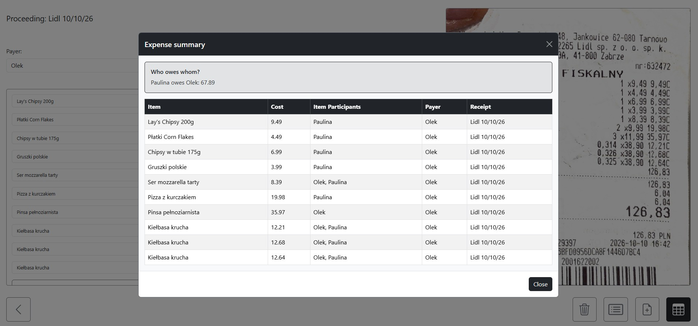

# OCR Receipt Splitter

Split shared expenses without working out every repayment by hand. Create an
expense, add the people involved, enter receipt items, and see a clear summary
of who owes whom.

> Receipt scanning is optional: you can add a receipt locally and enter its
> items yourself, or use TabScanner OCR.

## Screenshots

<p align="center">
  
</p>
<p align="center"><em>The receipt workspace: review scanned items, choose who shares each item, and compare them with the original receipt.</em></p>

<table>
  <tr>
    <td align="center" width="50%">
      
      <br><em>Your saved expenses at a glance.</em>
    </td>
    <td align="center" width="50%">
      
      <br><em>Create an expense and add its participants.</em>
    </td>
  </tr>
  <tr>
    <td align="center" width="50%">
      
      <br><em>Choose TabScanner OCR or a local receipt upload.</em>
    </td>
    <td align="center" width="50%">
      
      <br><em>Review item costs and see who owes whom.</em>
    </td>
  </tr>
</table>

## Features

- Create expenses with any number of participants.
- Add multiple receipts to an expense.
- Upload receipt images locally or scan them with TabScanner OCR.
- Assign each receipt to the person who paid for it.
- Split individual line items between selected participants.
- Review an itemized summary and suggested repayments.
- Save expenses in the browser with IndexedDB.

## Tech stack

- **Frontend:** HTML, CSS, and vanilla JavaScript.
- **UI and styling:** Bootstrap 5.
- **Browser storage:** IndexedDB.
- **Backend proxy:** C# and ASP.NET Core minimal APIs on .NET 10, hosted by Kestrel.
- **Receipt OCR:** TabScanner API.

## How splitting works

The app calculates a balance for each participant, in cents, for every valid
line item:

1. The item's price is divided equally between the participants selected for
   that item.
2. The full item price is credited to the person who paid for the receipt.
3. Each selected participant's share is subtracted from their balance.

A positive balance means the participant should receive money; a negative
balance means they owe money.

For example, if Alex pays **60.00** for an item shared by Alex, Blake, and
Casey, each share is **20.00**. After accounting for Alex's payment, the
balances are:

| Participant | Balance |
| --- | ---: |
| Alex | +40.00 |
| Blake | -20.00 |
| Casey | -20.00 |

The app suggests that Blake and Casey each pay Alex 20.00. When a price does
not divide evenly into cents, the remaining cents are assigned one at a time
in the order the participants appear on the item.

To turn balances into repayments, the app matches people who owe money with
people who should receive money, applying the smaller remaining balance to
each suggested payment until the balances are settled. This produces a valid
settlement, but it does not necessarily find the solution with the fewest
transfers.

An item is excluded from the repayment calculation if its price is missing or
invalid, no payer is selected, or no participants are assigned. The summary
still lists receipt items separately from the repayment calculation.

## Getting started

### Requirements

- A modern browser.
- A static web server. The project is configured for VS Code Live Server on
  port `5500`.
- .NET 10 SDK and a TabScanner API key for OCR scanning.

You can use local receipt uploads and enter items yourself without configuring
the TabScanner proxy.

### 1. Configure TabScanner (optional)

To use OCR, first create an account at
[tabscanner.com](https://tabscanner.com/). Sign in, open the **API Keys** tab,
and select **+ Add API Key** to create a key. Copy the key; you will add it to
the `ApiKey` field below.

From the repository root, copy the example settings file:

```powershell
Copy-Item api/proxy/appsettings.example.json api/proxy/appsettings.json
```

Edit `api/proxy/appsettings.json` and replace:
- `ApiKey` is the api key you created. 
- `Region` is the two-letter ISO 3166-1 country code for the receipt's country. See the supported codes in the [TabScanner regions documentation](https://docs3.tabscanner.com/#regions).
- `Link` is the TabScanner **Base URL** listed in the
[API introduction](https://docs3.tabscanner.com/). Currently it's https://api3.tabscanner.com/
- `Url` - is the address and port the proxy listens on. It should match the proxy URL configured in js/config.js (for example, http://localhost:5229). You may leave it as is if not necessary.

```json
{
  "Kestrel": {
    "Endpoints": {
      "Http": {
        "Url": "http://localhost:5229"
      }
    }
  },
  "TabScanner": {
    "ApiKey": "your-api-key",
    "Region": "two-char-region",
    "Link": "https://api3.tabscanner.com/"
  }
}
```

The proxy requires all values to start. Keep your real API key out of source control; `appsettings.json` is excluded by `.gitignore`.

### 2. Start the OCR proxy

In a terminal at the repository root:

```powershell
cd api/proxy
dotnet run --no-launch-profile
```

The proxy listens on `http://localhost:5229`, as configured in
`appsettings.json`. A `launchSettings.json` profile is not required. The
frontend's proxy address is set separately in `js/config.js`.

### 3. Start the frontend

Open the repository root with VS Code, start Live Server, and open `index.html`
at `http://127.0.0.1:5500` or `http://localhost:5500`.

If you use a different frontend or proxy address, update `js/config.js` and the
proxy's CORS allowed origins in `api/proxy/Program.cs` as needed.

## Project structure

```text
api/proxy/  ASP.NET Core proxy for TabScanner
assets/     App icon and images
css/        App styles
js/         Frontend, IndexedDB, and proxy configuration
pages/      Expense workspace
index.html  Expense list and creation
```

## Data and privacy

Expense data is stored in the browser using IndexedDB. When you choose OCR,
the selected receipt image is sent through the local proxy to TabScanner for
processing. Do not put your TabScanner API key in frontend code or publish it
in the repository.
